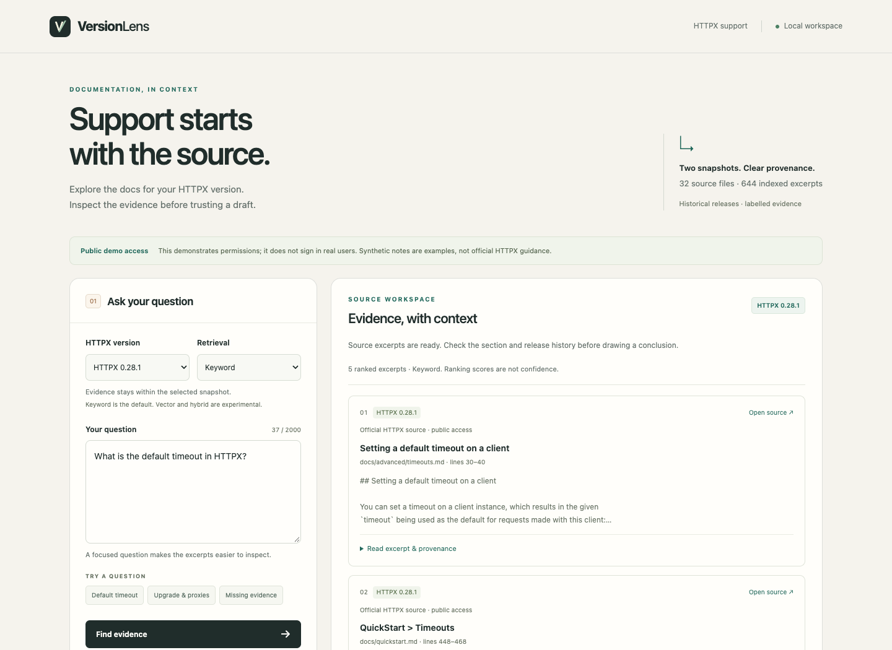

# VersionLens

**Version-aware technical support for HTTPX, running entirely on your computer.**
Search pinned documentation, inspect original evidence and ask a local model for
cited drafts. Switch the product version or a simulated permission profile to
see how accessible evidence changes.

**Release status: local prototype.** The API, browser interface, incremental
updates and evaluation tools are implemented. Answer quality is not yet
human-validated. The small local model has known conflict-handling and upgrade
reasoning failures; drafts must be checked against their sources.



## Run it

Requires **Python 3.11+ with SQLite FTS5**. Clone or download this repository,
then run from its root:

```sh
git clone https://github.com/UttamBhavani007/versionlens.git
cd versionlens
python3 scripts/run_local.py
```

Open **http://127.0.0.1:8765**. The launcher verifies the bundled source files,
creates a missing index and starts the foreground API/UI. Stop with Ctrl-C.
No Python packages, model, account or API key are needed for keyword search,
source inspection or missing-evidence abstention.

```sh
python3 scripts/run_local.py --prepare  # prepare without serving
python3 scripts/run_local.py --check    # inspect readiness without changing files
```

A different existing index is preserved; choose the corpus explicitly before
using `--rebuild`. See [local deployment](docs/LOCAL_DEPLOYMENT.md) for readiness,
synthetic documents, platform limits and clean-setup verification. This release
is deployed from its source checkout, including its corpus and manifests.

## What it demonstrates

- **Exact versions:** HTTPX 0.27.2 and 0.28.1, with 32 pinned source files and
  644 line-preserving chunks. Immutable commits, SHA-256 hashes and original
  line ranges accompany evidence. These are historical demonstration versions.
- **Retrieval:** SQLite FTS5 keyword search, local Nomic cosine search and fixed
  reciprocal-rank fusion. Keyword remains the default; no reranker was added.
- **Local cited drafts:** source/quote identity validation, explicit abstention,
  bounded requests and no remote inference fallback. Literal quotes do not
  establish semantic support; answers expose `semantic_support_verified: false`.
- **Updates and simulated permissions:** transactional snapshot changes,
  deletion, stale-vector rejection, access filtering before retrieval and
  context assembly, and evidence rechecks around generation.
- **Inspectable interface:** responsive browser workspace, version selection,
  source inspection and separate evidence, draft and error states.
- **Evaluation engineering:** grouped development/holdout candidates,
  digest-bound human review gates, citation audits and separate claim reviews.

Two opt-in MIT-licensed fictional runbooks demonstrate permission and version
changes. Profiles are selected at server startup; they simulate permissions and
provide no production sign-in or protection for real confidential documents.
The [interview walkthrough](docs/INTERVIEW_DEMO.md) reproduces the demonstration.

## Optional free local models

The pinned runtime installer supports **Apple Silicon macOS**. In one terminal:

```sh
python3 scripts/local_runtime.py install
python3 scripts/local_runtime.py serve
```

In another terminal:

```sh
python3 scripts/local_runtime.py pull
python3 scripts/local_runtime.py pull --embedding
PYTHONPATH=src python3 -m versionlens embed
python3 scripts/run_local.py
```

Generation uses Apache-2.0 `qwen3:1.7b` (about 1.4 GB); embeddings use Apache-2.0
`nomic-embed-text:v1.5` (about 274 MB). Downloads are explicit, weights stay local,
Ollama cloud features are disabled and the adapter accepts only loopback model
endpoints without redirects or inherited proxies. Stop the foreground model
server with Ctrl-C. [Setup and model provenance](docs/LOCAL_MODELS.md).

**No paid services are used:** no OpenAI API, hosted database, cloud inference,
card-backed trial or automatic billing. Deployment is local; there is no public
hosted endpoint. Existing hardware, disk, electricity and download bandwidth
remain resources you supply. [Cost policy](docs/COST_POLICY.md).

## Measured behavior and limits

The [25 October development run](reports/day6-development-evaluation.json)
executed **40 AI-authored development questions × three retrievers**. The
positive-anchor denominator was 19 per method; labels are provisional and
nonexhaustive, and the questions were not held out.

| Retrieval | Known-anchor hit at 5 | Known-anchor MRR at 5 |
| --- | --- | --- |
| Keyword | 17/19 | 0.7228 |
| Vector | 17/19 | 0.7895 |
| Hybrid | 18/19 | 0.7675 |

These are retrieval observations, **not answer accuracy**. All 55 returned
citations passed mechanical source/quote checks, yet **12/15 synthetic-conflict
trials returned drafts despite provisional abstention labels**, even when both
sources were found. Real upgrade probes have also been withheld as
`invalid_generation`. Experimental vector/hybrid generation requires a keyword
match first; this conservative gate does not establish semantic support.

The 100-question draft pack contains 40 development and **60 unexecuted candidate
holdout questions**. All question reviews and 51 generated-answer trial reviews
remain pending. No reviewed holdout results, semantic citation-correctness score
or unsupported-answer rate are claimed. Human question-label review and human
claim review are separate requirements.

[Results, timing, cost and limitations](docs/EVALUATION_RESULTS.md) ·
[Question review pack](docs/evaluation/review-pack/QUESTIONS.md) ·
[Answer review pack](docs/evaluation/answer-review-pack/ANSWERS.md)

## Verify and explore

```sh
python3 scripts/fetch_sources.py --check
PYTHONPATH=src python3 -W error::ResourceWarning -m unittest discover -s tests -v
python3 scripts/check_clean_setup.py --output reports/local/my-clean-setup.json
```

The clean-setup verifier requires Git and local repository history. It uses a
temporary source archive and a pip-free virtual environment. It checks ingestion, the API/UI assets, both versions, source
inspection and model-free abstention. It downloads no models and runs no holdout.
**Verified on 27 October:** [299 software tests and 14 API checks](reports/day7-clean-setup.json)
passed from a fresh archive of commit `94b796b` in a pip-free Python 3.13.7
virtual environment. [12 browser checks](reports/day7-browser-check.json) passed
against the real running interface, with actual desktop/mobile/source captures.
No models or holdout questions were run again in these release checks.
The final documentation commit adds these reports without changing application
code. Software checks do not measure answer correctness.

[Architecture](docs/ARCHITECTURE.md) · [API](docs/API.md) ·
[Updates and access simulation](docs/PERMISSIONS_AND_UPDATES.md) ·
[Actual screenshots](docs/SCREENSHOTS.md) · [Release notes](docs/RELEASE_NOTES.md) ·
[Development log](docs/DEVELOPMENT_LOG.md) · [Delivery plan](docs/DELIVERY_PLAN.md)

## License

Project code and synthetic fixtures: [MIT](LICENSE). Bundled HTTPX sources retain
their upstream BSD license and attribution. Model weights are not distributed
with the repository. [Third-party notices](THIRD_PARTY_NOTICES.md).
