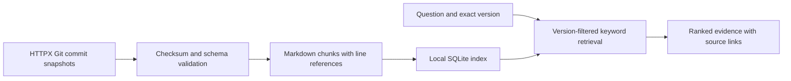

# Architecture and boundaries

## Implement first

Only ingestion and retrieval belong to day 1. The planned extensions are local
vector and hybrid retrieval, optional reranking after comparison, local
generation, API/UI, document updates, and synthetic access-controlled documents.

## Version policy

- A request selects an explicit supported snapshot: `0.27.2` or `0.28.1`.
- Missing, ambiguous, and unsupported versions are errors; never silently use
  the newest version.
- All candidates are filtered to the requested version before ranking.
- A changelog is a historical document available in a given snapshot; a release
  mentioned inside it is not the same thing as the snapshot version. Preserve
  the section heading so that generation can distinguish the two.
- Cross-version comparisons will be explicit requests with separate retrieval
  for each version, not an unfiltered search.
- Updates replace a complete snapshot transactionally; incomplete downloads do
  not partially overwrite an existing index.

## Evidence and access

Each chunk carries a source ID, snapshot version, upstream commit, source
checksum, section, line range, and immutable source URL. Source identity and
permissions are server-controlled metadata, never instructions taken from
document text. Day 1 accepts only public HTTPX documentation; no private corpus
or authorization claims exist yet.

Later synthetic internal documents must be prominently labelled. Permissions
must constrain candidates before ranking and before any model context is built.
Role switching in an interview demo is not production authentication.

## Evaluation boundaries

Retrieval relevance is separate from answer faithfulness and citation support.
A valid source ID or quoted span alone does not establish that every generated
claim is supported. Do not label automatic checks as human review. Holdout
questions must not be used to tune chunk size, thresholds, or prompts.
