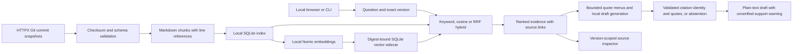

# Architecture and boundaries

## Implemented through day 4

The application uses Python's standard library, SQLite and project-local Ollama.
A loopback-only API and bundled browser workspace expose the same validated
application operations. Incremental document updates and synthetic
access-controlled documents remain planned. Reranking is deferred because the first development comparison does
not justify additional complexity.

The vector sidecar records the complete corpus fingerprint, embedding model
digest, dimensions and preprocessing revision. Publication occurs only after
every full-input embedding validates; a final source snapshot check rejects
concurrent changes. Queries reject missing/stale/corrupt/incomplete caches and
score only the requested snapshot. Cosine search scans this small corpus
directly; no approximate index or hosted vector database is needed.

Hybrid uses fixed RRF with constant 60 and twenty candidates per engine. It
checks source consistency across both retrieval calls and uses chunk IDs to
break ties. A broken vector index is an error, never an implicit keyword fallback.
Raw BM25 and cosine scores are not combined as if they shared a scale.

Keyword retrieval remains the default. Experimental vector/hybrid answer modes
require a keyword match before retrieval/generation, because dense neighbors
alone do not establish answerability. This conservative veto can miss relevant
semantic paraphrases and does not validate entailment. Search-only comparisons
do not apply this generation gate.

## Local API and browser boundary

The standard-library HTTP server binds only to literal `127.0.0.1`. An explicit
asset allowlist, exact Host/Origin checks, strict bounded JSON, eight handler
slots, read timeouts and a single POST operation limit protect this workstation
demo. It is not an authenticated public server. See [the API contract](API.md).

Source inspection resolves a validated chunk ID within the selected snapshot;
clients cannot supply filesystem paths. The browser builds nodes with plain
text, validates immutable citation URLs and invalidates results when inputs
change. Aborted or late responses cannot replace evidence for a newer question
or version. Browser cancellation does not stop backend model work.

The interface calls only its local same-origin API. No external fonts, libraries,
analytics or cloud model calls are loaded. Opening a source link is an explicit
user navigation to the pinned upstream GitHub document.

## Version policy

- A request selects an explicit supported snapshot: `0.27.2` or `0.28.1`.
- Missing, ambiguous, and unsupported versions are errors; never silently use
  the newest version.
- All candidates are filtered to the requested version before ranking.
- A changelog is a historical document available in a given snapshot; a release
  mentioned inside it is not the same thing as the snapshot version. Preserve
  the section heading so that generation can distinguish the two.
- Cross-version comparisons will be explicit requests with separate retrieval
  for each version, not an unfiltered search.
- Updates replace a complete snapshot transactionally; incomplete downloads do
  not partially overwrite an existing index.

## Evidence and access

Each chunk carries a source ID, snapshot version, upstream commit, source
checksum, section, line range, and immutable source URL. Source identity and
permissions are server-controlled metadata, never instructions taken from
document text. Day 1 accepts only public HTTPX documentation; no private corpus
or authorization claims exist yet.

Later synthetic internal documents must be prominently labelled. Permissions
must constrain candidates before ranking and before any model context is built.
Role switching in an interview demo is not production authentication.

## Evaluation boundaries

Retrieval relevance is separate from answer faithfulness and citation support.
A valid source ID or quoted span alone does not establish that every generated
claim is supported. Do not label automatic checks as human review. Holdout
questions must not be used to tune chunk size, thresholds, or prompts.
