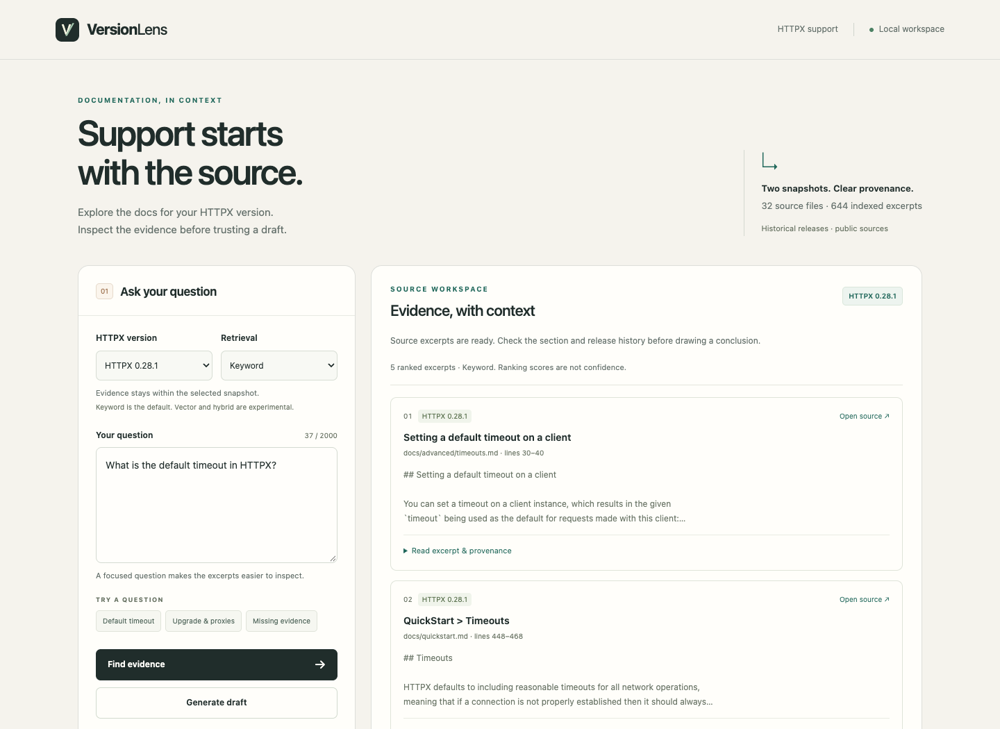
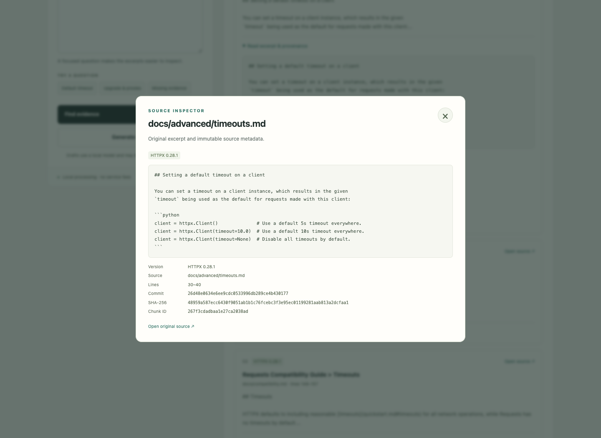
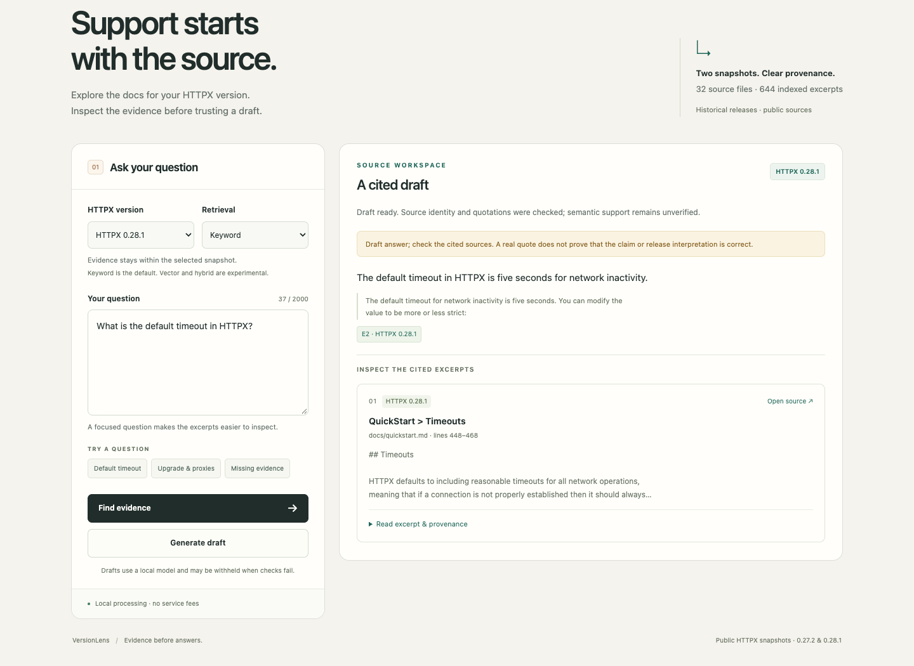
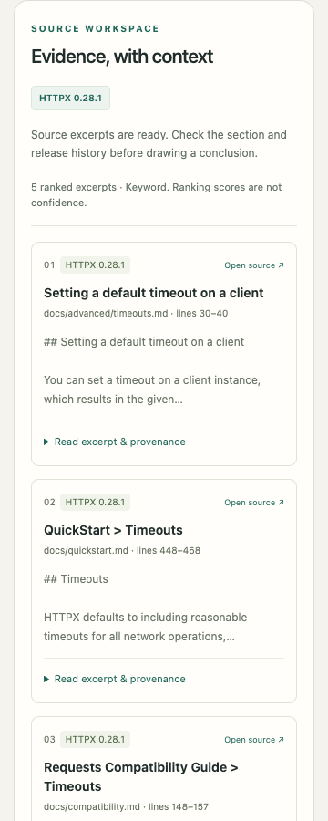

# Actual local application screenshots

Captured from the running application using real API responses on 24 October
2026 (Europe/Berlin). No response fixtures or generated mockups were used for
these images. The [browser report](../reports/day4-browser-check.json) records
the browser version, checks and implementation hashes. The local servers are
stopped after verification; these images do not imply a public hosted endpoint.

## Evidence workspace

## Source inspection

## Cited draft

Quotation identity checks do not establish semantic support. The upgrade probe
still fails validation and is withheld; the [API report](../reports/day4-http-smoke.json)
retains this result.

## Mobile evidence

