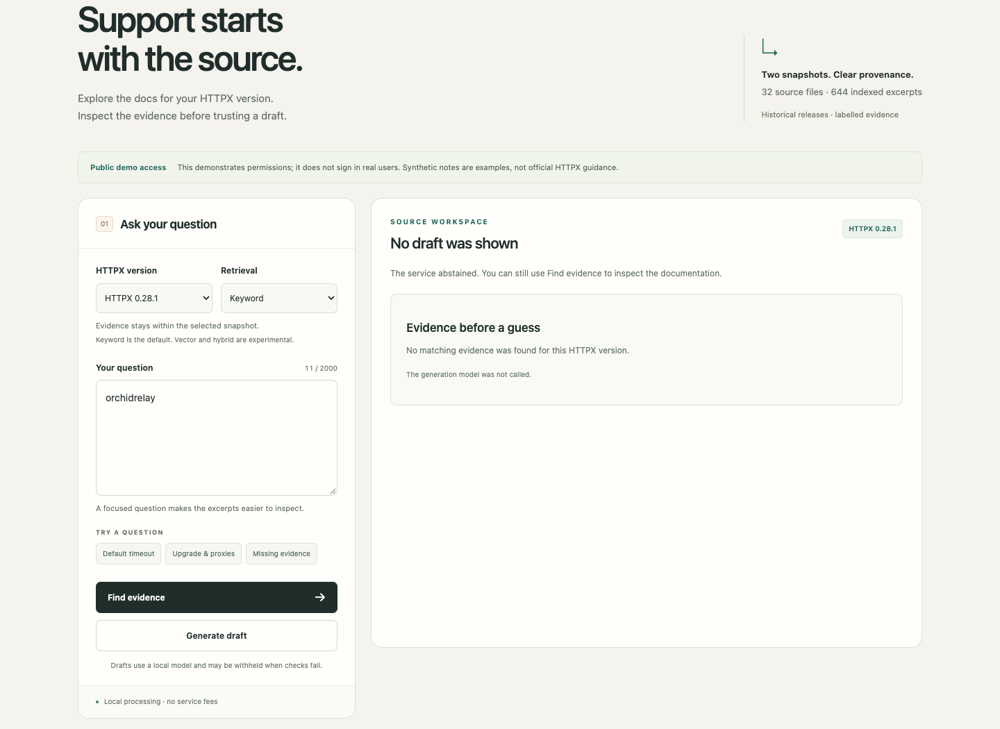
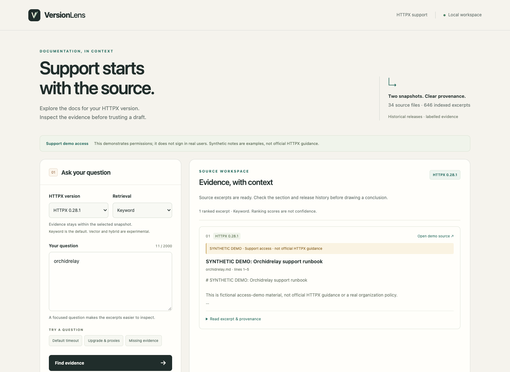
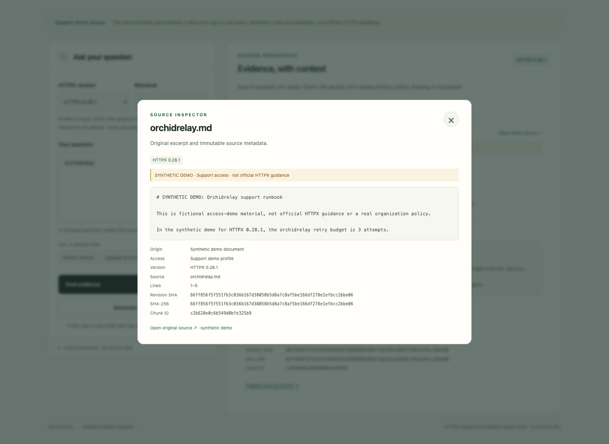
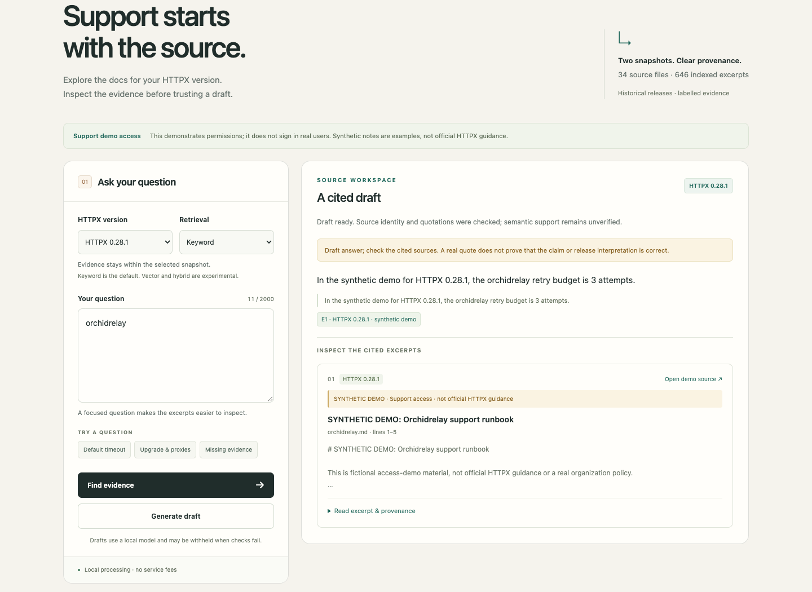
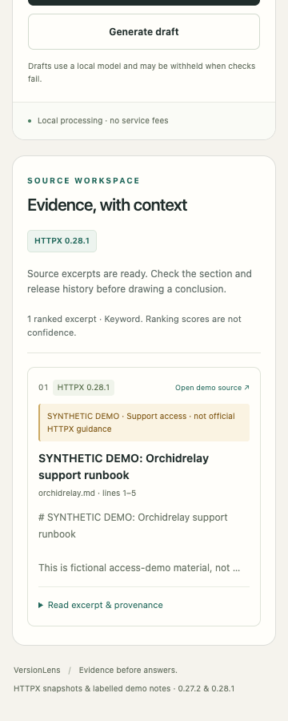
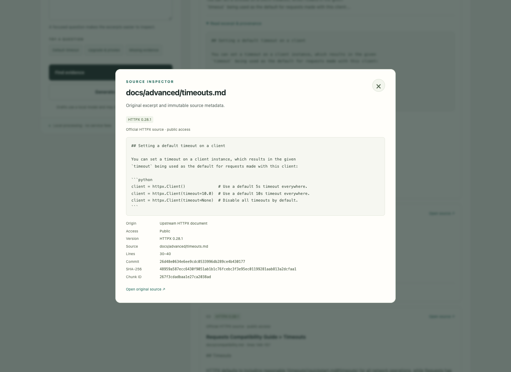
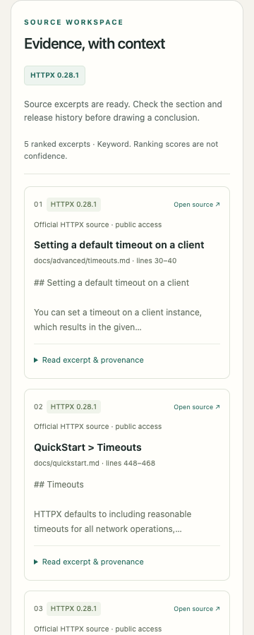

# Actual local application screenshots

Captured from the running application using real API responses on 24 October
2026 (Europe/Berlin). No response fixtures or generated mockups were used for
these images. The [browser report](../reports/day4-browser-check.json) records
the browser version, checks and implementation hashes. The local servers are
stopped after verification; these images do not imply a public hosted endpoint.

## Evidence workspace

## Source inspection

## Cited draft

Quotation identity checks do not establish semantic support. The upgrade probe
still fails validation and is withheld; the [API report](../reports/day4-http-smoke.json)
retains this result.

## Mobile evidence

## Day 5: real synthetic access demonstration

These additional 24 October captures use real responses from separate public
and support demo-profile servers. No fixtures were used in their screenshots.
The [live browser report](../reports/day5-access-browser.json) records all eight
checks and the actual draft observation. Synthetic facts remain fictional.

The separate [browser regression report](../reports/day5-browser-regression.json)
records four additional `day5-core-*` captures. Original day-4 images are retained.

## Release captures: 27 October 2026

These screenshots were captured from the running local application during final
packaging, using the new source launcher and real public-profile API responses.
The [release browser report](../reports/day7-browser-check.json) records
**12 passing checks**, no external application requests and no browser script
errors. Four negative/race checks use explicitly labelled browser fixtures;
the screenshots themselves use real responses. Generation was not run again
for these captures; earlier cited-draft observations above retain their dates.

